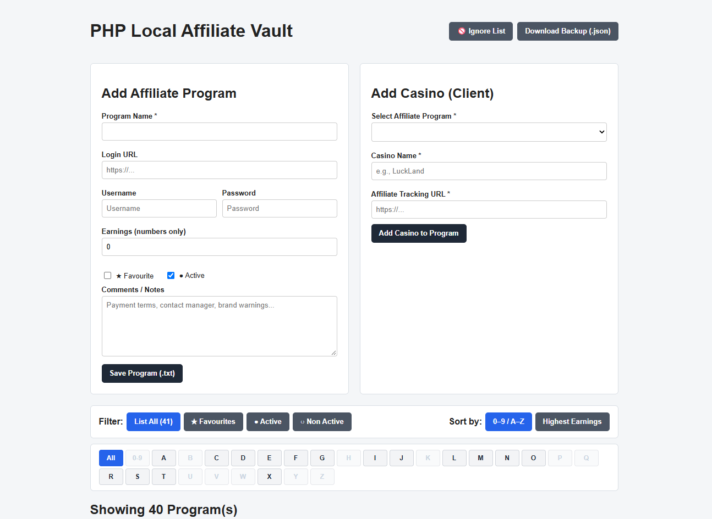

# PHP Local Affiliate Vault

A lightweight, database-free PHP web application to organize affiliate programs, casino brands (clients), tracking URLs, login credentials, earnings, and an ignore list—stored locally as human-readable JSON/text files.

## Features

- **Zero Database Setup:** Stores each affiliate program as a formatted JSON `.txt` file inside `/data` for easy portability and manual editing.
- **Brand & Tracking Link Management:** Group multiple casino/client brands under each affiliate program with one-click tracking URL copying, inline URL updates, and active/inactive toggles.
- **Fast Filtering & Sorting:**
  - Filter by status (**All**, **Favourites**, **Active**, **Non Active**).
  - Alphabetical quick-jump bar (**0–9**, **A–Z**) that automatically highlights available letters.
  - Sort alphabetically or by **Highest Earnings**.
- **Built-in Ignore List:** Dedicated plain-text `ignore_list.txt` editor to track rogue, closed, or blacklisted programs so you never research the same bad program twice.
- **Credential Vault:** Mask/unmask passwords and click-to-select usernames.
- **One-Click JSON Backup:** Export all your affiliate programs into a single timestamped `.json` backup file.

## Installation

1. Clone or download this repository into your local web server folder (e.g., **XAMPP**, **Laragon**, **MAMP**, or PHP's built-in server).
2. Make sure PHP 7.4+ (or PHP 8.x) is installed and has write permissions to the root folder and `/data`.
3. Open `index.php` in your browser (e.g., `http://localhost/php-local-affiliate-vault/`).

> **Security Note:** This tool is designed for **local use only** (`localhost`) and does not include user authentication. Do not host it on a public web server without adding password protection (e.g., HTTP Basic Auth) and HTTPS.

## License

MIT License — free to use, modify, and share.
